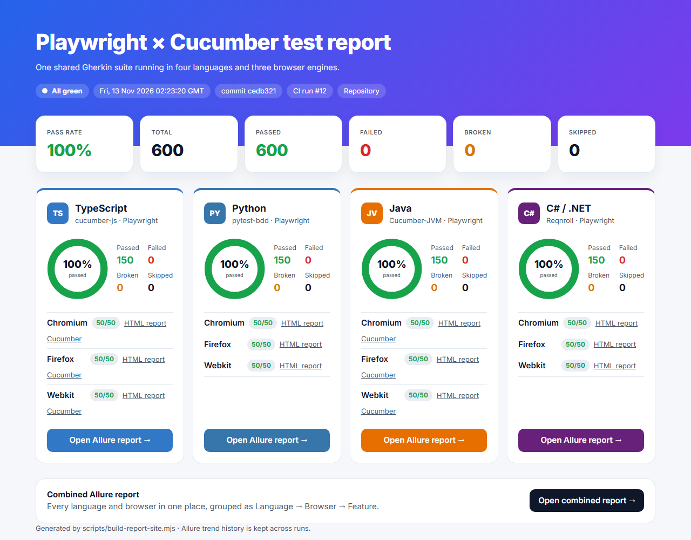
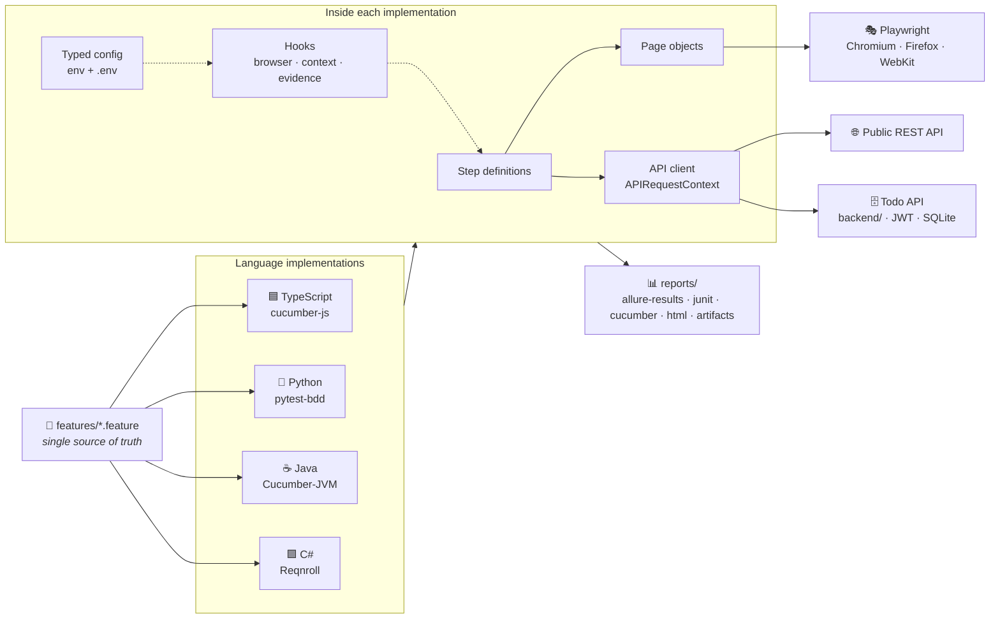
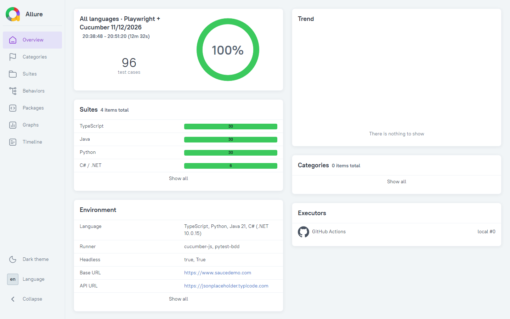
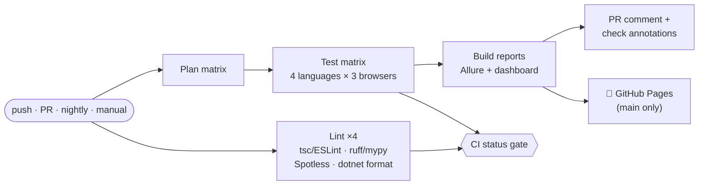

<div align="center">

# 🎭 auto-playwright

### One Gherkin suite. Four languages. Three browser engines. Reports you'll actually want to open.

A test automation framework built on **Playwright** and **Cucumber BDD**, implemented side by side in
**TypeScript, Python, Java and C#**. Every implementation runs the *same* feature files, writes the *same*
report layout, and is wired into a CI/CD pipeline that publishes a live dashboard of Allure reports.

[](https://github.com/omarva/auto-playwright/actions/workflows/ci.yml)
[](https://github.com/omarva/auto-playwright/actions/workflows/docker.yml)
[](https://github.com/omarva/auto-playwright/actions/workflows/codeql.yml)
[](https://omarva.github.io/auto-playwright/)


[**Live dashboard**](https://omarva.github.io/auto-playwright/) ·
[Quick start](#-quick-start) ·
[Demo](#-see-it-in-action) ·
[Architecture](#-architecture) ·
[Reports](#-reporting) ·
[API & back-end](#%EF%B8%8F-api--back-end-testing) ·
[CI/CD](#-cicd-pipeline) ·
[Writing tests](#-writing-a-new-scenario)



</div>

---

## ✨ Highlights

<table>
<tr>
<td width="50%" valign="top">

**🧩 One spec, four languages**<br>
All Gherkin lives in [`features/`](features). TypeScript, Python, Java and C# each run it directly, with no copies, so the languages can't drift apart.

**🌐 UI + API + back-end + accessibility**<br>
Browser journeys (login → cart → checkout), REST and JSON-schema contract tests, a bundled JWT-secured [Todo API](backend) with full CRUD coverage, and axe-core WCAG 2.1 AA scans.

**🧪 Built for flake resistance**<br>
Web-first assertions, role and test-id locators, an isolated browser context per scenario, retries in CI, and traces on failure.

</td>
<td width="50%" valign="top">

**📊 Reporting**<br>
Allure (per language + combined, with trend history), Cucumber HTML, language-native HTML dashboards, JUnit XML, screenshots, videos and Playwright traces.

**🚀 CI/CD ready**<br>
GitHub Actions matrix of 4 languages × 3 browsers, lint gates, PR test comments, nightly regression, GitHub Pages deploys, Docker images on GHCR, CodeQL and Dependabot.

**⚙️ Zero-config defaults**<br>
Clone and run. Every knob (browser, tags, parallelism, retries, tracing, video) is one environment variable that means the same thing in every language.

</td>
</tr>
</table>

## 🗺️ The four implementations

| | Language | BDD runner | Assertions | Native HTML report | Parallelism | Lint |
|---|---|---|---|---|---|---|
| 🟦 | [**TypeScript**](typescript) | cucumber-js 13 | Playwright `expect` | multiple-cucumber-html-reporter | worker processes | tsc · ESLint · Prettier |
| 🐍 | [**Python**](python) | pytest-bdd 9 | Playwright `expect` | pytest-html | pytest-xdist | ruff · mypy `--strict` |
| ☕ | [**Java**](java) | Cucumber-JVM 8 + JUnit Platform | AssertJ + Playwright | masterthought cucumber-reporting | JUnit threads | Spotless (google-java-format) |
| 🟪 | [**C# / .NET**](dotnet) | Reqnroll 3 + NUnit | AwesomeAssertions + Playwright | Reqnroll Cucumber HTML | NUnit workers | `dotnet format` + analyzers |

All four write **Allure results**, **JUnit XML** and **Cucumber JSON/messages** to the same folder layout.

---

## 🚀 Quick start

> **Prerequisites:** only the toolchain for the language you want. Or just Docker, see [below](#-docker).

<details open>
<summary><b>🟦 TypeScript</b>: Node 22+</summary>

```bash
cd typescript
npm ci
npx playwright install --with-deps
npm test               # full suite
npm run report         # build and open the reports
```
</details>

<details>
<summary><b>🐍 Python</b>: Python 3.12+</summary>

```bash
cd python
python -m venv .venv && source .venv/bin/activate    # Windows: .venv\Scripts\activate
pip install -r requirements-dev.txt
playwright install --with-deps
pytest
allure serve reports/allure-results
```
</details>

<details>
<summary><b>☕ Java</b>: JDK 21 (Maven is bundled via the wrapper)</summary>

```bash
cd java
./mvnw -B exec:java@install-browsers
./mvnw -B verify       # note: verify, not test
./mvnw allure:serve
```
</details>

<details>
<summary><b>🟪 C# / .NET</b>: .NET 10 SDK + PowerShell</summary>

```bash
cd dotnet
./run-tests.sh --install-browsers      # Windows: ./run-tests.ps1 -InstallBrowsers
allure serve reports/allure-results
```
</details>

### Pick what to run

The same variables work in every language:

```bash
TAGS="@smoke"                     npm test     # only smoke scenarios
TAGS="@cart and not @negative"    pytest       # Cucumber tag expressions everywhere
BROWSER=webkit PARALLEL=4         ./mvnw -B verify
HEADLESS=false SLOW_MO=300        ./run-tests.sh
```

| Variable | Default | |
|---|---|---|
| `BROWSER` | `chromium` | `chromium` · `firefox` · `webkit` |
| `TAGS` | `not @wip` | Cucumber tag expression |
| `HEADLESS` / `SLOW_MO` | `true` / `0` | watch the browser, slow it down |
| `PARALLEL` / `RETRIES` | `2` / `0` | workers and retries for failed scenarios |
| `TRACE` / `VIDEO` / `SCREENSHOT` | `retain-on-failure` / `off` / `only-on-failure` | evidence capture |
| `BASE_URL` / `API_BASE_URL` | saucedemo.com / jsonplaceholder | systems under test |
| `BACKEND_URL` / `BACKEND_REQUIRED` | `http://localhost:3000` / `false` | bundled Todo API; skipped if it's down unless required |

The full contract is in [docs/CONVENTIONS.md](docs/CONVENTIONS.md). Each project also reads an optional `.env` file (see `.env.example`).

---

## 🎬 See it in action

The [`@demo`](features/demo/playwright_site.feature) feature is a short, self-contained tour of the framework: it opens
[playwright.dev](https://playwright.dev), follows links using role-based locators, runs a data-driven outline across
all four Playwright language docs, and attaches screenshots to the report. Run it **headed and slowed down** to watch it:

| TypeScript | Python | Java | C# |
|---|---|---|---|
| `npm run demo` | `pytest --demo` | `./mvnw -B verify -Pdemo` | `./run-tests.sh --demo` |

```gherkin
@ui @demo
Feature: Framework demo - a tour of playwright.dev

  Scenario Outline: Installation guide exists for <language>
    When I open the "<language>" installation guide
    Then the URL should contain "<path>"
    And I should see the heading "Installation"

    Examples:
      | language | path               |
      | Node.js  | /docs/intro        |
      | Python   | /python/docs/intro |
      | Java     | /java/docs/intro   |
      | .NET     | /dotnet/docs/intro |
```

---

## 🏗️ Architecture



**Lifecycle (identical in every language):**

1. **One browser per worker**, launched lazily, so `@api` scenarios never start one.
2. **A fresh `BrowserContext` and `Page` per scenario**, giving full isolation (cookies, storage, cache).
3. **After each scenario:** on failure a full-page screenshot and a Playwright trace are attached to every report, video is kept if configured, then the context is closed.
4. API steps attach the **request and response** (status, headers, pretty JSON) to the report.

### Repository layout

```
auto-playwright/
├── features/                 # 📄 shared Gherkin, the only place scenarios live
│   ├── ui/                   #    login · inventory · cart · checkout · accessibility
│   ├── api/                  #    public REST API + JSON-schema contract
│   ├── backend/              #    Todo API: auth + CRUD
│   ├── demo/                 #    playwright.dev showcase
│   └── schemas/              #    JSON schemas shared by every language
├── typescript/               # 🟦 cucumber-js implementation
├── python/                   # 🐍 pytest-bdd implementation
├── java/                     # ☕ Cucumber-JVM implementation
├── dotnet/                   # 🟪 Reqnroll implementation
├── backend/                  # 🗄️ zero-dependency Todo API (JWT + SQLite) used as a system under test
├── scripts/
│   └── build-report-site.mjs # 📊 merges all results into Allure + the dashboard
├── docs/CONVENTIONS.md       # 📐 the cross-language contract
├── docker-compose.yml        # 🐳 run any language without local toolchains
└── .github/                  # 🤖 CI, Docker, CodeQL, Dependabot, templates
```

---

## 🧪 What's covered

| Feature | Scenarios | Highlights |
|---|:-:|---|
| 🔐 [Login](features/ui/login.feature) | 6 | Happy path, locked-out user, data-driven invalid credentials, logout |
| 🛍️ [Product catalogue](features/ui/inventory.feature) | 5 | Product count, sorting by name and price in both directions |
| 🛒 [Shopping cart](features/ui/cart.feature) | 3 | Add one or many (data tables), remove, badge state |
| 💳 [Checkout](features/ui/checkout.feature) | 4 | End-to-end purchase, totals, form validation outline |
| ♿ [Accessibility](features/ui/accessibility.feature) | 2 | axe-core WCAG 2.0/2.1 A and AA, fails on serious or critical issues |
| 🔌 [Posts REST API](features/api/posts.feature) | 7 | GET / filter / POST / PUT / PATCH / DELETE / 404, headers and fields |
| 📜 [API contract](features/api/contract.feature) | 4 | JSON-schema validation, nested paths, relationships, response-time budget |
| 🔑 [Todo API · auth](features/backend/auth.feature) | 7 | JWT login, invalid-credential outline, profile, missing and forged tokens |
| 🗄️ [Todo API · resources](features/backend/todos.feature) | 6 | Full CRUD lifecycle, filtering, cross-user isolation, validation, 404s, performance |
| 🎬 [Demo](features/demo/playwright_site.feature) | 6 | Navigation, outlines, screenshots attached to the report |

**50 scenarios × 4 languages × 3 browsers = 600 executions per CI run.**

Tags let pipelines pick a slice of the suite: `@ui` `@api` `@backend` `@contract` `@smoke` `@regression` `@negative` `@e2e` `@a11y` `@demo` `@wip`.

---

## 📊 Reporting

Every run produces several complementary reports. CI merges them into one
[**live dashboard**](https://omarva.github.io/auto-playwright/):

| Report | Where | Best for |
|---|---|---|
| **Report dashboard** | GitHub Pages `/` | At-a-glance health across languages and browsers |
| **Allure, combined** | `/allure/combined/` | Everything grouped Language → Browser → Feature, with trends |
| **Allure, per language** | `/allure/<language>/` | Steps, attachments, traces, retries and history per implementation |
| **Native HTML** | `/native/<language>/<browser>/` | Each ecosystem's own report (cucumber-html-reporter, pytest-html, masterthought, Reqnroll) |
| **Cucumber HTML** | `reports/cucumber/` | The official Cucumber report with embedded attachments |
| **JUnit XML** | `reports/junit/` | PR check annotations and test-result comments |
| **Playwright traces** | `reports/artifacts/traces/` | Time-travel debugging: `npx playwright show-trace <zip>` |

<div align="center">

</div>

Allure history survives between runs: before generating, CI downloads the previous report's `history/` from
the live site, so the **trend graphs** keep growing even though every deployment replaces the whole site.
Results are tagged with `Language` and `Browser` parameters, so a scenario that ran on three browsers is
three tests, never one test with "retries".

---

## 🤖 CI/CD pipeline



| Workflow | Trigger | What it does |
|---|---|---|
| [**CI**](.github/workflows/ci.yml) | push, PR, nightly 03:00 UTC, manual | Lint gates, the full test matrix, Allure + dashboard, PR test-result comments, Pages deploy |
| [**Docker**](.github/workflows/docker.yml) | Dockerfile/dependency changes, weekly | Builds each image, **runs `@smoke` inside it**, pushes to GHCR from `main` |
| [**CodeQL**](.github/workflows/codeql.yml) | push, PR, weekly | Security and quality analysis for Actions, TS, Python, Java, C# |
| [**Dependabot**](.github/dependabot.yml) | weekly | Grouped updates for npm, pip, Maven, NuGet, Docker and Actions |

**Run it on demand:** *Actions → CI → Run workflow* lets you choose the language, browser and tag expression.

**Branch protection:** require the single **`CI status`** check, which fails if any lint or test job fails.

---

## 🗄️ API & back-end testing

The [`backend/`](backend) folder contains a **real back-end**: a zero-dependency Todo API (Node's `http`,
`sqlite` and `crypto` only) with JWT auth, per-user data isolation, strict validation and an
[OpenAPI 3.1 contract](backend/openapi.yaml). Start it with one command:

```bash
node backend/server.mjs        # http://localhost:3000 · users alice/wonderland, bob/canwefixit
```

Every language shares one **generic API step library** ([spec](docs/CONVENTIONS.md#7-api-step-library)),
so new API scenarios usually need **no new code**:

```gherkin
Background:
  Given I use the "todo" API
  And I am authenticated as "alice" with password "wonderland"

Scenario: Full CRUD lifecycle of a todo
  When I send a POST request to "/api/todos" with body:
    """json
    { "title": "Write Playwright tests" }
    """
  Then the response status should be 201
  And the response should match the "todo" schema
  When I store the response field "id" as "todoId"
  And I send a DELETE request to "/api/todos/${todoId}"
  Then the response status should be 204
```

| Capability | Example step |
|---|---|
| Any HTTP verb, with or without a JSON body | `I send a PATCH request to "…" with body:` |
| Auth | `I am authenticated as …` · `I am not authenticated` · `I use the bearer token …` |
| Variables | `I store the response field "id" as "todoId"`, then `${todoId}` in paths, bodies and expectations |
| Field checks (dot paths, array indexes) | `the response field "address.geo.lat" should be "-37.3159"` |
| Collections | `every item … should have field …` · `should (not) contain an item with field …` |
| Contracts | `the response should match the "todo" schema` (shared [JSON schemas](features/schemas)) |
| Performance budgets | `the response time should be below 1000 ms` |

Each request and response (headers, pretty JSON, duration) is attached to every report. CI starts the Todo API
next to every test job, and Docker runs each language image against a Todo API container.

---

## 🐳 Docker

No local toolchain? Every implementation ships an image built on Microsoft's official Playwright images:

```bash
docker compose run --rm typescript                          # one language
TAGS=@smoke docker compose up --abort-on-container-failure  # all four in parallel
```

Reports are written to `./<language>/reports` on the host. Images published from `main` are also available as
`ghcr.io/omarva/auto-playwright-<language>:latest`.

---

## ✍️ Writing a new scenario

1. **Write the Gherkin** in `features/`. Reuse existing steps where possible and tag it (`@ui`/`@api` plus `@smoke`/`@regression`).
2. **Find missing steps**: `cd typescript && npm run dry-run` lists any undefined step.
3. **Implement the step in all four languages.** Step wording is a shared API, and the PR template reminds you.
4. Put selectors in **page objects**, never in steps. Prefer `getByRole` / `getByTestId` (`data-test`).
5. Run locally, then open a PR. CI comments the results and links the reports.

```gherkin
@ui @cart @regression
Scenario: Cart keeps items after navigating away
  Given I am logged in as "standard_user"
  And I have added "Sauce Labs Backpack" to the cart
  When I open the cart
  Then the cart should contain:
    | Sauce Labs Backpack |
```

---

## 🛠️ Troubleshooting

<details>
<summary><b>A test failed in CI. How do I debug it?</b></summary>

Open the run's **Build report site** summary, or the [dashboard](https://omarva.github.io/auto-playwright/) → Allure.
Each failed scenario has a screenshot and a `playwright-trace` zip attached. Download the trace and run
`npx playwright show-trace trace.zip` to step through every action with DOM snapshots.
</details>

<details>
<summary><b>Browsers fail to launch on Linux</b></summary>

Install the system dependencies with the `--with-deps` flag (`npx playwright install --with-deps`), or use the Docker images.
</details>

<details>
<summary><b>Java runs zero tests</b></summary>

Scenarios run as integration tests through Failsafe, so use `./mvnw verify`, not `./mvnw test`.
</details>

<details>
<summary><b>Where do the systems under test come from?</b></summary>

[saucedemo.com](https://www.saucedemo.com) (a public demo store), [JSONPlaceholder](https://jsonplaceholder.typicode.com)
(a public fake REST API) and [playwright.dev](https://playwright.dev). Point `BASE_URL` / `API_BASE_URL` at your own
environments to reuse the framework.
</details>

---

<div align="center">

Built with 🎭 Playwright · 🥒 Cucumber · 📊 Allure

**© omarva. All rights reserved.**

</div>
